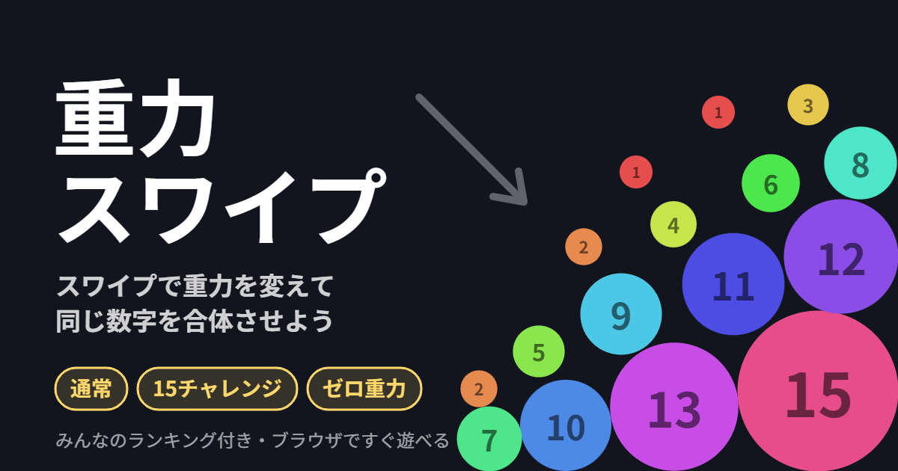

# 重力スワイプ

スワイプで重力の向きを変えて、同じ数字のボールをぶつけて合体させる、スマホ向けのブラウザゲームです。

▶ https://kamomutsu09-spec.github.io/gravity-merge/

## 遊び方

- スワイプした方向が「下」になり、ボールが流れます
- 指を始点から遠くへ動かすほど、重力が強くなります
- 同じ数字がぶつかると、次の数字に合体します(最大15)
- ボールは自動で降ってきます。80個以上の状態が2秒続くとゲームオーバー

## モード

| モード | 内容 |
|---|---|
| 通常モード | スコアを稼ぐ。15が3つくっつくと消えて +1,000,000 |
| 15チャレンジ | 15を作るまでのタイムを競う |
| ゼロ重力 | 重力なし。スワイプして指を離すと、その方向にボールを弾く |

## そのほか

- みんなのランキング(全期間・今日)と、この端末のランキング。登録した名前はあとから変更できます
- 結果を X でシェアできます
- 一時停止、効果音・振動(オン/オフ可)

物理演算には [Matter.js](https://brm.io/matter-js/)(MIT License)を使っています。
